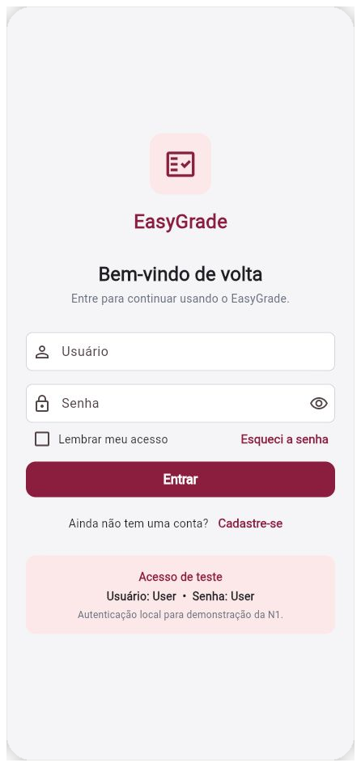
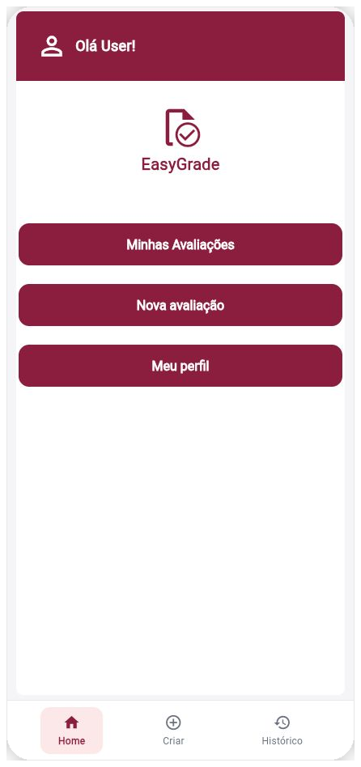
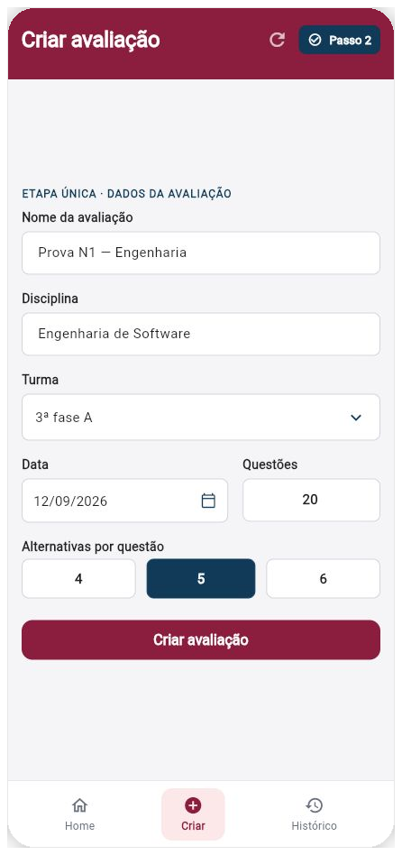
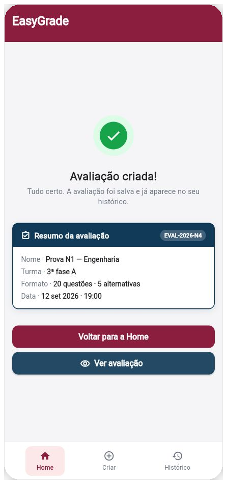
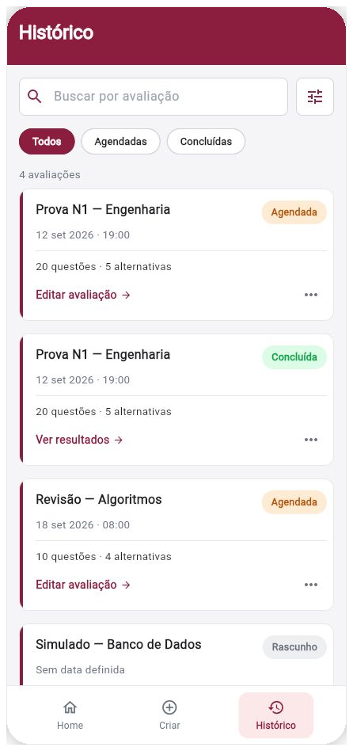
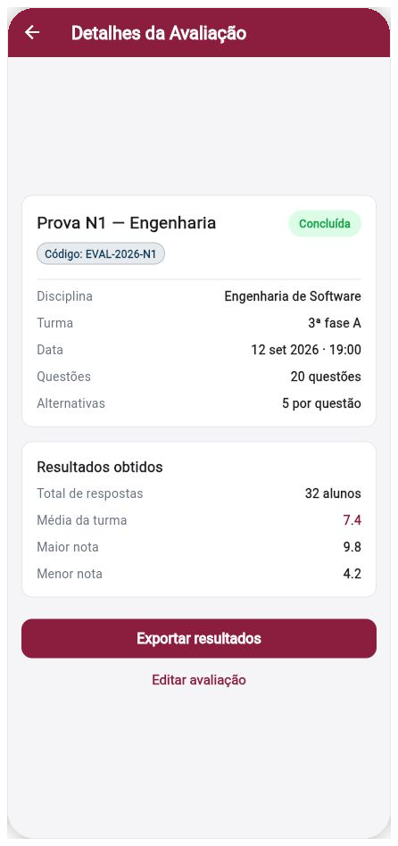

<p align="center">
  
</p>

<p align="center">
  Protótipo navegável para criação, organização e futura correção automatizada de avaliações.
</p>

## Resumo do projeto

**EasyGrade** é um app voltado a professores que precisam corrigir grandes volumes de avaliações objetivas. A proposta é reunir a criação das avaliações, a leitura das folhas de resposta, a correção automática e a consulta dos resultados em um fluxo simples.

Esta versão corresponde à **N1**: as telas são navegáveis e usam dados mock.

## Objetivo

Reduzir o tempo gasto na correção de provas e permitir que professores e alunos recebam os resultados com mais rapidez.

## Escopo da N1

| Incluído nesta entrega | Fora do escopo da N1 |
| --- | --- |
| Login, cadastro e recuperação de senha simulados | Autenticação real e persistência de usuários |
| Navegação entre as telas principais | Integração com banco de dados |
| Criação local de avaliações | Leitura de QR Code e folhas de resposta pela câmera |
| Histórico, busca, filtros e detalhes | Correção automática de provas |
| Resultados demonstrativos com dados mock | Exportação real para Excel e relatórios completos |
| Perfil e configurações locais | Importação de alunos e geração de provas individualizadas |

## Requisitos funcionais

| Código | Requisito | Situação na N1 |
| --- | --- | --- |
| RF01 | Permitir acesso, cadastro e recuperação de senha do professor. | Simulado |
| RF02 | Exibir uma tela inicial com acesso às funções principais. | Implementado |
| RF03 | Criar avaliações com nome, disciplina, turma, data, quantidade de questões e alternativas. | Implementado com dados locais |
| RF04 | Listar, buscar e filtrar avaliações por situação, disciplina, turma e período. | Implementado com dados mock |
| RF05 | Exibir os detalhes e a situação da avaliação: rascunho, agendada ou concluída. | Implementado |
| RF06 | Apresentar total de respostas, média, maior e menor nota. | Implementado com dados mock |
| RF07 | Ler gabaritos e folhas de resposta e corrigir as provas automaticamente. | Próximas etapas |
| RF08 | Exibir estatísticas por questão e alternativa assinalada. | Próximas etapas |
| RF09 | Gerar e exportar relatórios de notas em formato de planilha. | Próximas etapas |
| RF10 | Importar alunos e gerar provas ou gabaritos identificados e individualizados. | Próximas etapas |

## Requisitos não funcionais

| Código | Requisito |
| --- | --- |
| RNF01 | A interface deve ser simples, lógica e com poucos elementos por tela. |
| RNF02 | O layout deve priorizar celulares e adaptar o conteúdo a diferentes larguras. |
| RNF03 | A navegação e os filtros devem responder sem atrasos perceptíveis. |
| RNF04 | O código deve manter separação entre telas, modelos, dados, componentes e tema. |
| RNF05 | Dados de usuários e avaliações deverão ser protegidos quando houver backend e autenticação real. |
| RNF06 | O projeto deve usar Flutter e Dart para facilitar a manutenção e a execução multiplataforma. |

## Telas principais

<table>
  <tr>
    <td width="33.33%" align="center">
      <br>
      <strong>Login</strong><br>
      <sub>Valida o acesso demonstrativo e abre o fluxo principal.</sub>
    </td>
    <td width="33.33%" align="center">
      <br>
      <strong>Home</strong><br>
      <sub>Centraliza os atalhos para avaliações e perfil.</sub>
    </td>
    <td width="33.33%" align="center">
      <br>
      <strong>Criar avaliação</strong><br>
      <sub>Registra os dados básicos da avaliação.</sub>
    </td>
  </tr>
  <tr>
    <td width="33.33%" align="center">
      <br>
      <strong>Confirmação</strong><br>
      <sub>Resume a avaliação criada e confirma o salvamento local.</sub>
    </td>
    <td width="33.33%" align="center">
      <br>
      <strong>Histórico</strong><br>
      <sub>Lista, pesquisa e filtra as avaliações.</sub>
    </td>
    <td width="33.33%" align="center">
      <br>
      <strong>Resultados</strong><br>
      <sub>Apresenta os dados e indicadores da avaliação concluída.</sub>
    </td>
  </tr>
</table>

## Como executar

### Pré-requisitos

- [Flutter SDK](https://docs.flutter.dev/get-started/install) com Dart `>= 3.3.0 < 4.0.0`;
- Microsoft Edge ou Google Chrome para a execução Web;
- Android SDK e JDK 17 para executar ou compilar a versão Android.

### Passos

```bash
git clone https://github.com/Juuh1/EasyGrade.git
cd EasyGrade
flutter pub get
flutter run -d edge
```

### Acesso de teste

```text
Usuário: User
Senha: User
```

## Vídeo de apresentação

> https://youtu.be/tSS6fOFkVIA
