<p align="center">
  
</p>

# EasyGrade

Aplicativo Flutter para professores que corrigem avaliações objetivas em papel. O professor prepara o gabarito, identifica a folha de respostas do aluno, confere a leitura e acompanha notas e alternativas assinaladas.

Esta versão é o **protótipo N1**, com telas navegáveis, dados fictícios e estado em memória. Não há banco de dados, autenticação real, reconhecimento pela câmera ou serviços externos.

## Objetivo

Reduzir o trabalho de conferir cada questão manualmente e apoiar a devolutiva pedagógica com resultados individuais e análise das alternativas mais escolhidas. Os alunos fazem a prova física, entregam a folha de respostas e podem levar o caderno para estudar.

## O que funciona nesta N1

| Área | Experiência disponível |
| --- | --- |
| Abertura | Animação da marca com marcações, faixa de leitura e revelação do símbolo; opção de reduzir movimento |
| Acesso | Login User / User, cadastro, recuperação e alteração de senha demonstrativos |
| Avaliações | Criação, edição, duplicação, exclusão, busca, filtros por situação, disciplina, turma e período |
| Preparação | Gabarito manual ou lido de uma folha de exemplo; banco de questões local e seleção para o caderno |
| Turmas | Listagem, criação, inclusão e remoção de alunos; conferência e importação de uma lista de exemplo |
| Materiais | Prévia da folha identificada, caderno, opções de geração e organização lógica de páginas |
| Leitura | Seleção da avaliação e do aluno, identificação QR ilustrativa, leitura de marcações fictícias |
| Revisão | Conferência de marcações múltiplas e incertas, edição da alternativa e registro em branco |
| Resultados | Nota de 0 a 10, acertos, respostas por questão, média, maior e menor nota e alunos pendentes |
| Análise | Distribuição das alternativas, taxa de acerto, respostas em branco e alternativas mais assinaladas |
| Relatório | Prévia horizontal de uma planilha com matrícula, nota, acertos e alternativas marcadas |
| Perfil | Edição dos dados da sessão, configurações, ajuda e saída da conta |

Os dados desaparecem ao fechar ou recarregar o aplicativo. Trocar de aba preserva a busca e as informações da sessão. Nenhum e-mail, senha, arquivo ou imagem da câmera é enviado ou armazenado.

## Limites da entrega

Na N1, a câmera e o QR Code são simulados, a importação usa uma lista fixa e a exportação não gera um arquivo Excel. Impressão, geração de PDF/Word, paginação real e embaralhamento de provas também não estão implementados. A prévia utiliza uma única versão A, questões de peso igual e nota de 0 a 10. A integração com banco de dados pertence à N2 e não foi iniciada nesta reforma.

A [documentação da N1](docs/N1.md) relaciona as telas ao relato do cliente e descreve as regras da demonstração.

## Requisitos funcionais

| Código | Requisito | Situação na N1 |
| --- | --- | --- |
| RF01 | Permitir acesso, cadastro e recuperação de senha do professor. | Fluxos demonstrativos |
| RF02 | Exibir o início com acesso às tarefas do professor. | Navegável |
| RF03 | Criar e editar avaliação com turma, disciplina, data, questões e alternativas. | Em memória |
| RF04 | Buscar e filtrar avaliações por situação, disciplina, turma e período. | Dados da sessão |
| RF05 | Consultar detalhes e gerenciar avaliações. | Edição, duplicação, exclusão e conclusão locais |
| RF06 | Consultar resultados individuais e indicadores da turma. | Calculados sobre respostas fictícias |
| RF07 | Identificar, ler e corrigir folhas de respostas. | QR e captura simulados; comparação local com o gabarito |
| RF08 | Analisar alternativas marcadas por questão. | Distribuição calculada sobre resultados confirmados |
| RF09 | Gerar relatório de notas com respostas individuais. | Tela e prévia de planilha; exportação simulada |
| RF10 | Organizar/importar alunos e preparar folhas identificadas. | Dados locais e planilha de exemplo |
| RF11 | Criar questões e compor o caderno da avaliação. | Banco de questões em memória e prévia do caderno |
| RF12 | Configurar referência, conferir ambiguidades e reler um aluno. | Gabarito editável, revisão obrigatória e substituição sem duplicar |

## Requisitos não funcionais

| Código | Requisito |
| --- | --- |
| RNF01 | Interface simples, lógica e consistente, priorizando uma ação por etapa. |
| RNF02 | Layout para celular, com conteúdo limitado a 600 px em telas maiores e listas roláveis. |
| RNF03 | Dados de demonstração e buscas disponíveis sem backend. |
| RNF04 | Separação de modelos, estado da sessão, telas, tema e componentes compartilhados. |
| RNF05 | Sinalização explícita das ações simuladas e ausência de persistência na N1. |
| RNF06 | Implementação Flutter/Dart, idioma português brasileiro e fonte local. |
| RNF07 | Preferência de reduzir movimento, campos validados e suporte a texto ampliado. |

## Telas

<table>
  <tr>
    <td align="center">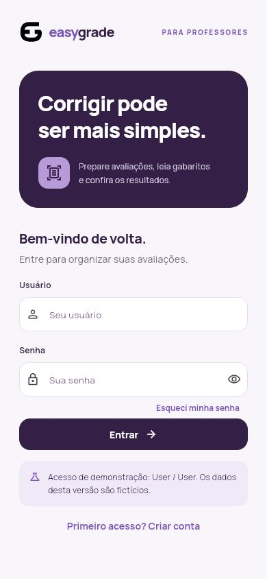<br><strong>Acesso</strong></td>
    <td align="center">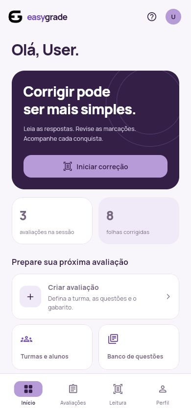<br><strong>Início</strong></td>
    <td align="center">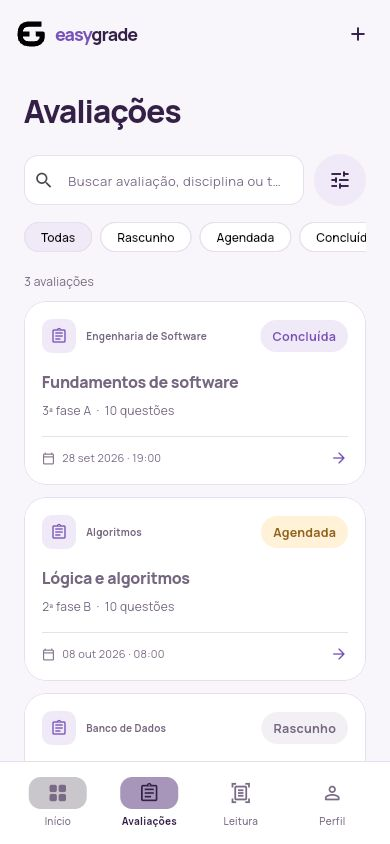<br><strong>Avaliações</strong></td>
  </tr>
  <tr>
    <td align="center">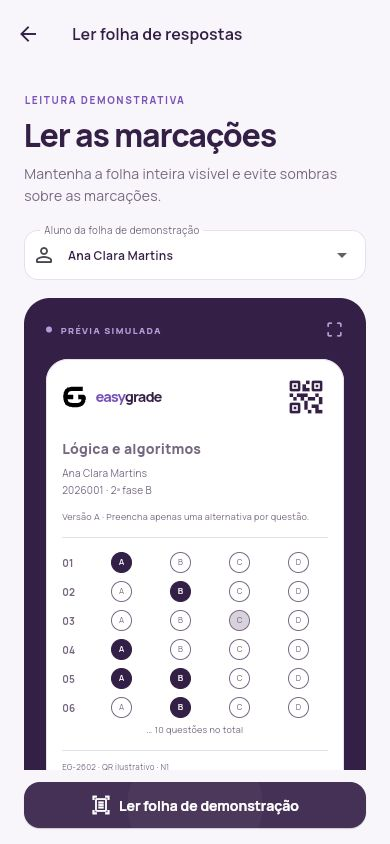<br><strong>Leitura</strong></td>
    <td align="center">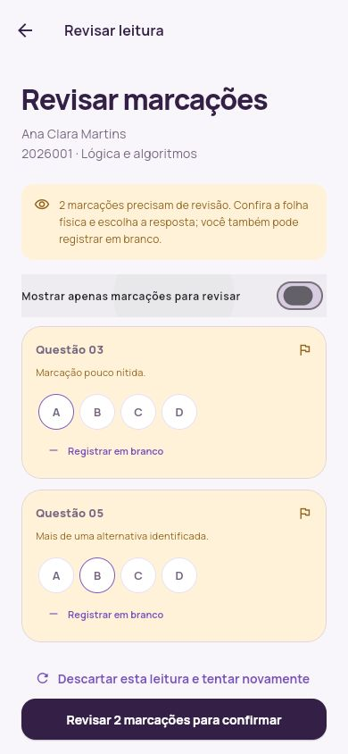<br><strong>Revisão</strong></td>
    <td align="center">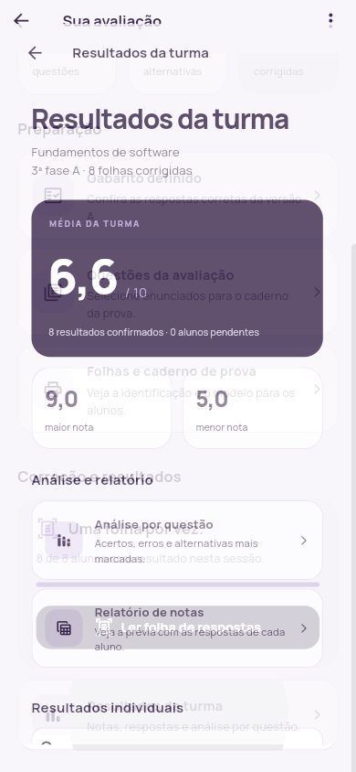<br><strong>Resultados</strong></td>
  </tr>
  <tr>
    <td align="center">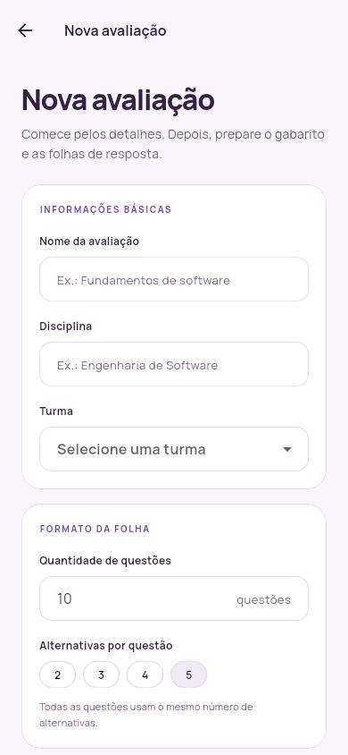<br><strong>Preparação</strong></td>
    <td align="center">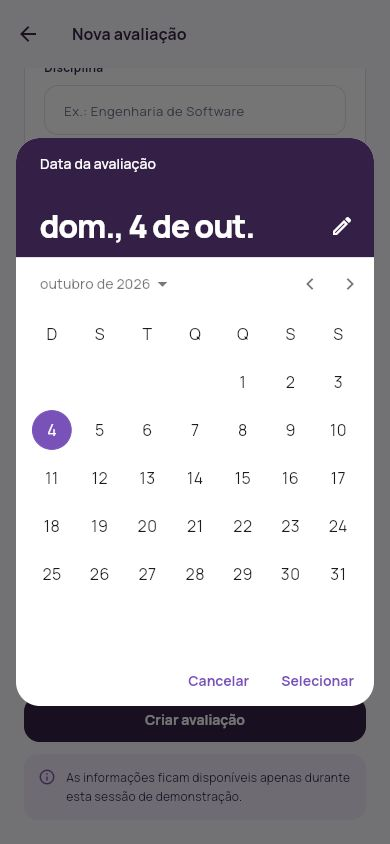<br><strong>Calendário</strong></td>
    <td align="center">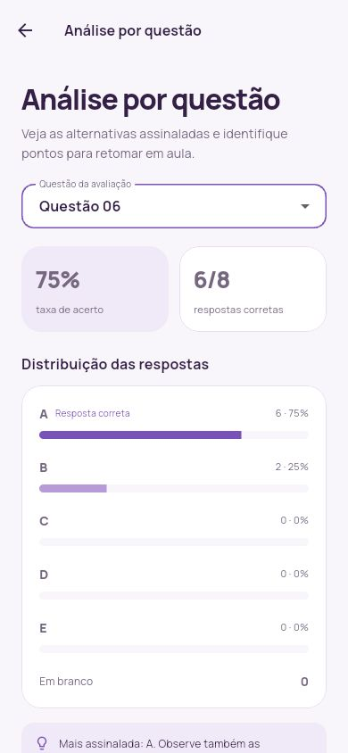<br><strong>Análise</strong></td>
  </tr>
  <tr>
    <td align="center">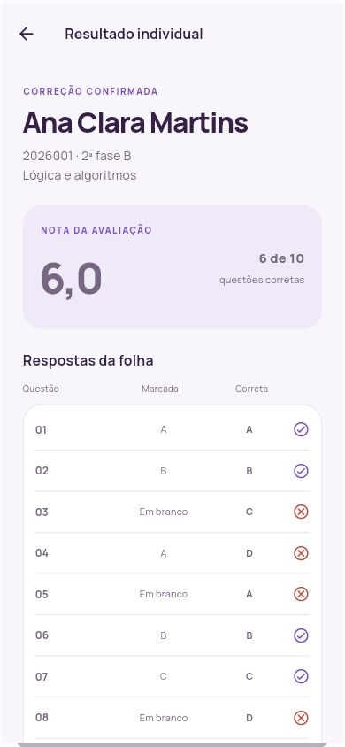<br><strong>Resultado individual</strong></td>
    <td align="center">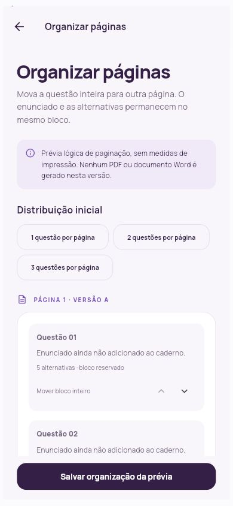<br><strong>Páginas</strong></td>
    <td align="center"><a href="docs/images/easygrade/n1/preview.png">Visão geral</a></td>
  </tr>
</table>

As demais telas incluem cadastro, recuperação de acesso, edição e confirmação de avaliação, gabarito, seleção para leitura, resultado individual, relatório, turmas, alunos, importação demonstrativa, banco e criação de questões, materiais, perfil, edição de perfil, alteração demonstrativa de senha, configurações e ajuda.

## Como executar

Requisitos: Flutter com Dart `>= 3.3.0 < 4.0.0`, navegador Edge/Chrome para Web e Android SDK/JDK compatíveis para Android. A reforma foi verificada com Flutter 3.47.2 e Dart 3.13.2.

```bash
flutter pub get
flutter run -d edge
```

**Acesso de demonstração:** usuário `User`, senha `User`.

```bash
flutter analyze
flutter test
flutter build web
flutter build apk --release
```

O Flutter gera o APK em `build/app/outputs/flutter-apk/app-release.apk`. Uma cópia é disponibilizada localmente em `entrega/EasyGrade-N1-reformulado.apk`. A entrega anterior e seus mockups foram guardados localmente em `tmp/arquivo-n1`, fora do versionamento.

## Estrutura e validação

- `lib/data/session_store.dart`: estado efêmero compartilhado e operações locais.
- `lib/data/mock_data.dart`: avaliações, turmas, alunos e questões fictícias.
- `lib/models/`: avaliação, filtro, questão, aluno e correção.
- `lib/theme/` e `lib/widgets/`: paleta, tipografia e componentes comuns.
- `lib/screens/`: fluxos navegáveis da N1.
- `test/`: notas, ambiguidade, releitura, isolamento, navegação, calendário e layout em 320/430 px com texto ampliado.

O monograma EG contínuo usa branco sobre roxo no ícone de instalação e preto sem fundo dentro do aplicativo. A identidade usa roxo `#7952B9`, roxo profundo `#342047`, lavanda `#B79AD8` e lilás `#F0EAF8`. A fonte [Manrope](https://github.com/google/fonts/tree/main/ofl/manrope) está incluída com sua [licença OFL](assets/fonts/OFL.txt).

## Apresentação anterior

[Vídeo da primeira entrega](https://youtu.be/tSS6fOFkVIA). O vídeo registra a versão anterior à reforma.
