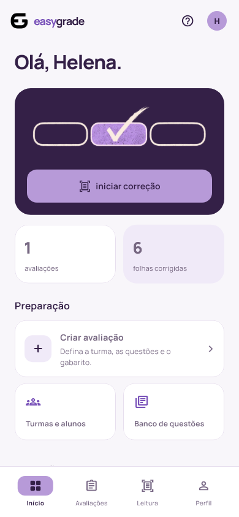
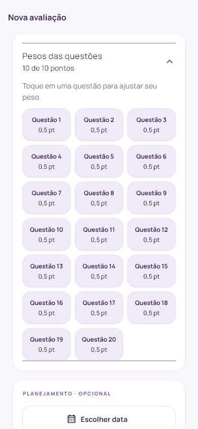
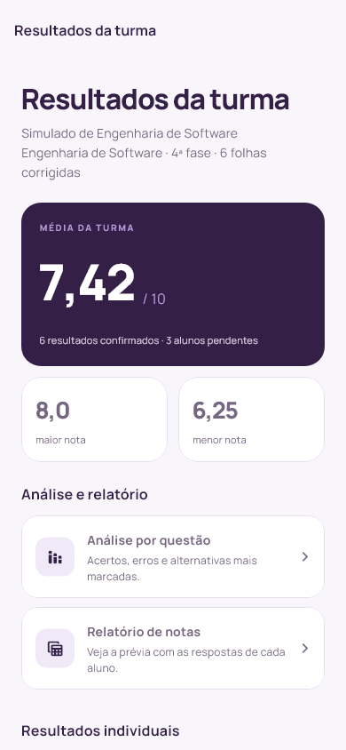

<p align="center">
  
</p>

# EasyGrade

**Entrega final N3 · Android · versão 1.0.0, build 6**

Aplicativo para professores prepararem avaliações objetivas em papel, imprimirem folhas identificadas, corrigirem respostas por foto e consultarem notas e análises.

**[Manual do usuário](manual/README.md)** · **[APK Android](EasyGrade.apk)**

**Turmas e alunos → avaliação e gabarito → impressão → leitura e revisão → resultados.**

## Escopo e requisitos funcionais

As colunas mostram o estado de cada entrega, da mais recente para a mais antiga. Os códigos abaixo seguem o agrupamento final; a N1 inclui seu protótipo e sua reformulação.

| Requisito | N3 · final | N2 · integração | N1 · protótipo |
| --- | --- | --- | --- |
| **RF01 · Acesso** | Cadastro, e-mail/senha ou Google, recuperação de senha e sessão. | Autenticação real por e-mail e Google. | Acesso e cadastro simulados. |
| **RF02 · Avaliações** | Criar, editar, duplicar, excluir e concluir; filtros, gabarito, planejamento e pesos. | Avaliações e gabaritos persistidos. | Criação, histórico e filtros com dados locais. |
| **RF03 · Turmas e alunos** | Matrículas, cadastros e importação por XLSX, CSV ou texto. | Cadastros e importação reais. | Cadastros locais e importação de exemplo. |
| **RF04 · Questões e materiais** | Banco, paginação, versões A/B, PDF da turma e cadernos Word. | Banco persistido, PDF e versões embaralhadas. | Banco local e prévias de materiais na reformulação. |
| **RF05 · Correção** | Foto pela câmera/galeria, QR, aplicação de pesos e revisão antes de confirmar. | Identificação e leitura reais das folhas. | Leitura e correção simuladas na reformulação. |
| **RF06 · Resultados** | Notas individuais, indicadores da turma, análise por questão e Excel. | Resultados e exportação reais. | Resultados fictícios e prévia de planilha. |
| **RF07 · Perfil e preferências** | Edição de perfil, pontuação padrão e ajuda. | Perfil e preferências vinculados à conta. | Perfil e configurações locais. |

As funções da N2 permanecem na N3. As diferenças de códigos e o detalhamento de cada etapa estão nos [registros históricos](#histórico-preservado).

As avaliações aceitam **1 a 60 questões** e **2 a 5 alternativas**. É possível usar uma prova feita fora do app, definindo apenas o gabarito; as folhas de respostas são geradas pelo EasyGrade. Para gerar o caderno completo, selecione os enunciados no banco.

## Requisitos não funcionais

| Requisito | N3 · final | N2 · integração | N1 · protótipo |
| --- | --- | --- | --- |
| **RNF01 · Privacidade** | Dados separados por conta, autenticação e regras de acesso. | Isolamento por usuário no Firestore. | Proteção prevista para a integração. |
| **RNF02 · Fotos locais** | Identificação e marcações processadas no aparelho; fotos não enviadas ao banco. | Processamento local da leitura. | Leitura simulada. |
| **RNF03 · Usabilidade** | Português, interface móvel, campos validados e suporte a texto ampliado. | Interface integrada aos dados reais. | Protótipo navegável e identidade visual. |
| **RNF04 · Conectividade** | Internet necessária para acesso e dados da conta. | Autenticação e persistência online. | Dados fictícios em memória. |
| **RNF05 · Revisão** | Marcações incertas impedem confirmar; releitura substitui o resultado. | Revisão e confirmação da leitura real. | Conferência demonstrativa na reformulação. |
| **RNF06 · Organização** | Camadas separadas, dependências declaradas e testes incluídos. | Separação entre interface, domínio e dados. | Arquitetura Flutter/Dart. |
| **RNF07 · Consistência** | Formato, composição e pesos preservados após a primeira correção. | Controle das alterações da avaliação. | Restrições locais na reformulação. |

## Telas

<table>
  <tr>
    <td align="center"><br>Início</td>
    <td align="center"><br>Avaliação</td>
    <td align="center"><br>Resultados</td>
  </tr>
</table>

O [manual ilustrado](manual/README.md) apresenta as telas de acesso, cadastros, questões, avaliação, gabarito, impressão, captura, revisão, resultados, relatórios e perfil. As imagens usam dados fictícios.

## Equipe

| Integrante |
| --- |
| Jorge Luiz Horn Júnior |
| Juliana Maria de Azevedo |
| Lorenzo Foralasso Kochemberger |
| Eduardo Coelho |

## Histórico preservado

| Entrega | Registro |
| --- | --- |
| **N3** | Versão final descrita neste README, manual ilustrado e APK. |
| **N2** | [README completo da N2](historico/N2/README.md), com comparação de requisitos, decisões, backlog e responsáveis. |
| **N1** | [Registro da N1](historico/N1/README.md), com fluxo, escopo e decisões do protótipo; [vídeo da primeira entrega](https://youtu.be/tSS6fOFkVIA). |

Os arquivos históricos mantêm o contexto da época, incluindo funções que eram simuladas ou que mudaram. O uso da versão final está descrito no [manual do usuário](manual/README.md).

<details>
<summary><strong>Informações para desenvolvimento</strong></summary>

Flutter/Dart, Firebase Authentication, Cloud Firestore, leitura local de imagens, PDF/Printing e Excel/CSV. A fonte Manrope acompanha sua [licença OFL](assets/fonts/OFL.txt).

Use Flutter compatível com Dart 3.11 ou superior, Java 17 e o Android SDK/NDK solicitado pelo Flutter.

```sh
flutter pub get
flutter run
flutter analyze
flutter test
flutter build apk --release
```

A configuração pública está em `lib/firebase_options.dart`; as regras e índices estão em `firestore.rules` e `firestore.indexes.json`. Uma assinatura Android diferente exige cadastrar seu SHA para o login Google. A APK acadêmica usa a assinatura local já utilizada pelo projeto.

Os testes opcionais das regras usam o Emulator e o projeto de demonstração `demo-easygrade`:

```sh
npm ci
npm run test:firestore
```

`build/` e os caches são gerados localmente e ficam fora do repositório e do ZIP. O pacote de entrega contém o código-fonte, as configurações, os testes, o README, o manual, o histórico e a APK.

</details>
