<p align="center">
  
</p>

# Manual do usuário

**EasyGrade · Android · versão 1.0.0, build 7**

Revisão: 21/11/2026 · Público: professores e responsáveis pela aplicação de avaliações objetivas.

Este manual explica como preparar uma prova em papel, imprimir as folhas da turma, corrigir as respostas e consultar as notas. Não exige conhecimento de programação. Os nomes, as turmas e os resultados das imagens são fictícios; as capturas mostram a interface atual renderizada em tamanho de celular.

**[Voltar ao projeto](../README.md)**

## Sumário

1. [Instalar e acessar](#1-instalar-e-acessar)
2. [Conhecer o início](#2-conhecer-o-início)
3. [Cadastrar turmas e alunos](#3-cadastrar-turmas-e-alunos)
4. [Preparar o banco de questões](#4-preparar-o-banco-de-questões)
5. [Criar a avaliação e ajustar pesos](#5-criar-a-avaliação-e-ajustar-pesos)
6. [Definir o gabarito e as questões](#6-definir-o-gabarito-e-as-questões)
7. [Gerar versões e imprimir a turma](#7-gerar-versões-e-imprimir-a-turma)
8. [Ler e revisar uma folha](#8-ler-e-revisar-uma-folha)
9. [Consultar resultados e exportar](#9-consultar-resultados-e-exportar)
10. [Perfil, preferências e saída](#10-perfil-preferências-e-saída)
11. [Resolver dúvidas e problemas](#11-resolver-dúvidas-e-problemas)
12. [Termos usados no aplicativo](#12-termos-usados-no-aplicativo)

## 1. Instalar e acessar

Use Android 7.0 ou superior e tenha conexão com a internet. Para fotografar no Android, permita o acesso à câmera quando solicitado. A impressão exige acesso a uma impressora ou a um serviço que aceite PDF.

### Instalar no Android

1. Transfira o arquivo [EasyGrade.apk](../EasyGrade.apk) para o celular.
2. Abra-o pelo aplicativo de arquivos.
3. Se o Android solicitar autorização para instalar por essa origem, permita a instalação e volte ao arquivo.
4. Toque em **Instalar** ou **Atualizar** e abra o EasyGrade.

Para atualizar, instale a nova APK sobre a anterior. Use a mesma conta para reencontrar seus dados; não é necessário recriar alunos ou avaliações.

### Entrar ou criar uma conta

- **Conta existente:** informe e-mail e senha e toque em **Entrar**.
- **Google:** toque em **Fazer login com o Google** e escolha a conta.
- **Nova conta:** toque em **Criar conta**, informe nome de usuário, nome do professor, e-mail e senha de pelo menos seis caracteres. A instituição é opcional. Confirme em **Criar conta**.

O nome de usuário serve à identificação do perfil. Para o acesso com senha, use o **e-mail**, não apenas o nome de usuário. Uma conta sem foto usa a inicial do nome.

<p> 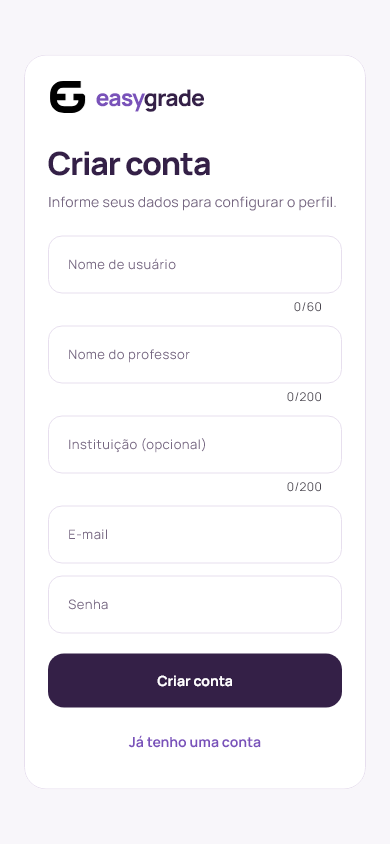</p>

### Recuperar a senha

1. Na tela de acesso, toque em **Esqueci minha senha**.
2. Informe o e-mail da conta e toque em **Enviar link**.
3. Confira a caixa de entrada e o spam; abra o link recebido e defina uma senha nova.
4. Volte ao EasyGrade e entre com a nova senha.

O link se aplica à conta que usa senha. Para uma conta acessada exclusivamente pelo Google, use o acesso Google e os recursos de recuperação dessa conta.

## 2. Conhecer o início

As abas inferiores organizam o aplicativo:

| Aba | Para que serve |
| --- | --- |
| Início | Acessar atalhos, avaliações recentes e **iniciar correção**. |
| Avaliações | Procurar avaliações e abrir seus detalhes. |
| Leitura | Escolher a avaliação para a leitura das folhas. |
| Perfil | Editar dados, configurar a pontuação padrão, consultar ajuda e sair. |

O botão **iniciar correção** leva à escolha da avaliação; ele não cria uma prova nova.

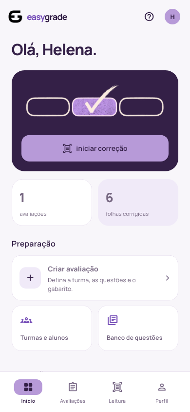

## 3. Cadastrar turmas e alunos

1. No início, abra **Turmas e alunos**.
2. Use a opção de adicionar uma turma e informe o nome.
3. Abra a turma e toque em **Adicionar aluno**.
4. Preencha **Nome completo** e **Matrícula** e confirme.

Use uma matrícula única dentro da turma. Ela permite identificar o aluno na correção. A turma também permite editar nomes e gerenciar seus alunos. Preserve as matrículas das folhas já impressas.

### Importar uma lista

1. Dentro da turma, abra **Importar lista de alunos**.
2. Abra um arquivo Excel (`.xlsx`) ou CSV, ou cole/digite uma lista.
3. Confira a prévia e confirme a importação.

Formato de exemplo:

```csv
Matrícula,Nome completo
2026001,Ana Ribeiro
2026002,Bruno Martins
```

Mantenha a matrícula como texto quando precisar preservar zeros à esquerda. Matrículas repetidas não criam um segundo aluno na mesma turma.

<p>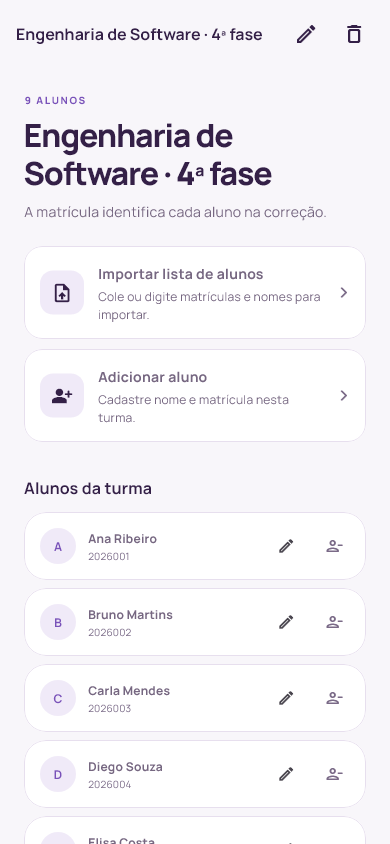 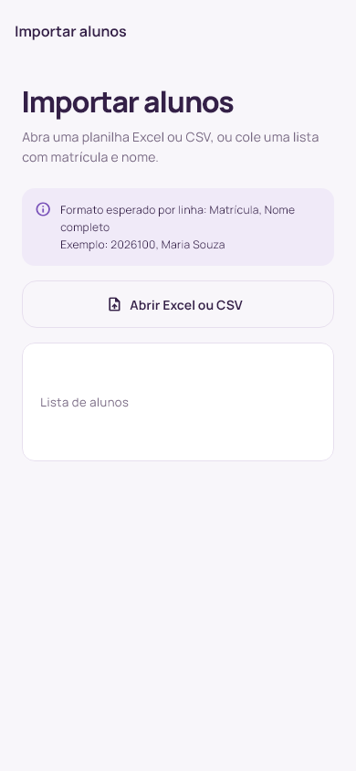</p>

## 4. Preparar o banco de questões

Abra **Banco de questões**, adicione uma questão e informe disciplina, enunciado, alternativas e resposta correta. Use a busca para localizar questões já cadastradas.

As questões usadas na mesma avaliação precisam ter a mesma quantidade de alternativas. Por exemplo: uma avaliação com quatro alternativas aceita questões com quatro opções; uma questão com cinco opções fica indisponível para essa avaliação.

Você pode corrigir uma prova elaborada fora do app sem cadastrar todos os enunciados. Nesse caso, defina o gabarito e gere as folhas de respostas pelo EasyGrade. O banco é necessário para o app montar o **caderno de questões**.

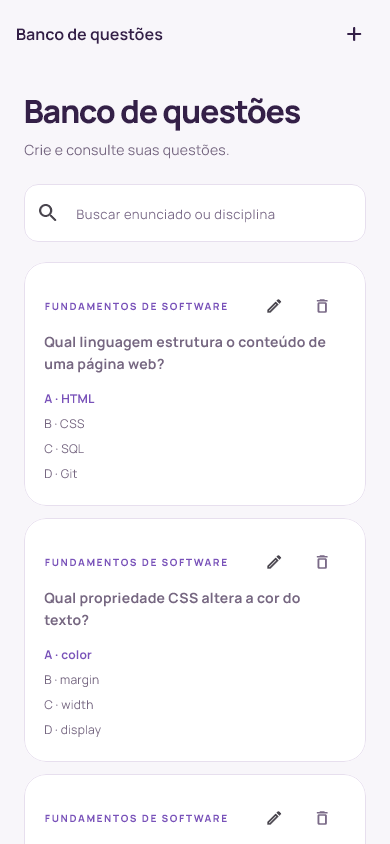

## 5. Criar a avaliação e ajustar pesos

1. Toque em **Criar avaliação**.
2. Informe nome, disciplina e turma.
3. Escolha de **1 a 60 questões** e de **2 a 5 alternativas por questão**.
4. Confira **Pesos das questões**.
5. Se desejar, informe data e horário em **Planejamento**.
6. Toque em **Criar avaliação**.

O planejamento é opcional e ajuda na organização e na busca por período. Ele não gera notificação de aplicação da prova.

### Entender a pontuação

A configuração de pontuação padrão define o limite das novas avaliações. Com limite de 10 pontos e 20 questões, o peso automático é **0,5 ponto por questão**.

Cada campo mostra a identificação da questão e seu peso. Toque nele, ajuste o valor e toque em **Aplicar**. **Usar automático** restaura o peso automático daquela questão.

Ao mudar um peso, os outros não são redistribuídos. Confira a soma antes de salvar: ela não pode superar o limite. Exemplo com 20 questões e total de 10 pontos, sendo a última de 1 ponto:

| Questões | Peso de cada uma | Subtotal |
| --- | --- | --- |
| 1 a 17 | 0,5 | 8,5 |
| 18 e 19 | 0,25 | 0,5 |
| 20 | 1 | 1 |
| **Total** | | **10** |

Os pesos ficam bloqueados após a primeira correção para preservar as notas da avaliação.

<p>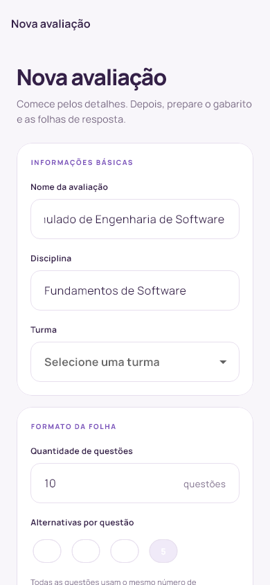 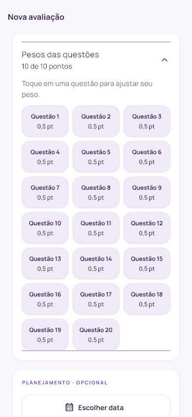</p>

## 6. Definir o gabarito e as questões

Nos detalhes da avaliação, abra **Preparar gabarito** ou **Gabarito definido**. Marque a alternativa correta de cada questão e toque em **Salvar gabarito**. Também é possível usar **Ler gabarito pela câmera**, fotografando a folha de referência na ordem da versão A.

Se montar o caderno pelo banco, abra **Questões da avaliação**, selecione os enunciados na ordem desejada e confirme em **Usar … questões**. A resposta correta cadastrada em cada enunciado atualiza o gabarito. Não é preciso manter duas respostas corretas independentes para a mesma questão.

Para uma prova feita fora do app, basta definir o gabarito correspondente e utilizar a folha EasyGrade. Para gerar o caderno completo, selecione todas as questões.

Alterar a composição antes da aplicação exige gerar novamente os modelos e materiais. Após a primeira correção, a composição fica preservada.

<p>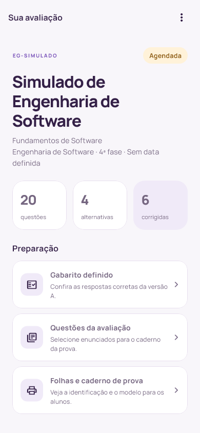 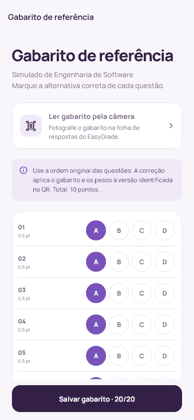</p>

## 7. Gerar versões e imprimir a turma

Nos detalhes, abra **Folhas e caderno de prova**.

### Usar versões A e B

1. Antes de imprimir, abra **Gerar versões A e B**.
2. Escolha se a versão B deve embaralhar as questões, as alternativas ou ambas.
3. Confirme a geração e use os materiais novos.

A versão A usa a ordem original. A B mantém a relação com as questões, alternativas corretas e pesos. O QR da folha identifica o modelo do aluno; não é necessário separar A e B em pilhas para informar a versão manualmente.

Gere as versões antes da impressão. Regenerar modelos torna os materiais anteriores desatualizados. Se um aluno for acrescentado depois, confira sua atribuição e gere sua folha pelo aplicativo.

### Imprimir todos os alunos de uma vez

1. Em **Alunos**, mantenha **Toda a turma**.
2. Escolha **Folhas de respostas em PDF**, **Cadernos de prova em PDF** ou **Exportar prova completa**.
3. Aguarde o documento e use a ação de impressão da visualização.
4. Escolha a impressora, papel A4 e tamanho original/100%. Envie o documento uma vez, com uma cópia de cada página.

O app reúne as páginas personalizadas em um único PDF. Os QR Codes diferentes não exigem confirmar uma impressão por aluno. Para imprimir apenas um aluno, escolha seu nome em vez de **Toda a turma**.

Você também pode salvar ou compartilhar o PDF e imprimi-lo depois. O **Word** permite editar os cadernos; mantenha a folha de respostas no PDF original do aplicativo. **Organizar páginas** permite distribuir blocos do caderno antes de gerar o arquivo.

A folha impressa deixa o campo **Nota** em branco para preenchimento do professor, sem “/10” fixo. O app calcula o resultado após a leitura e confirmação.

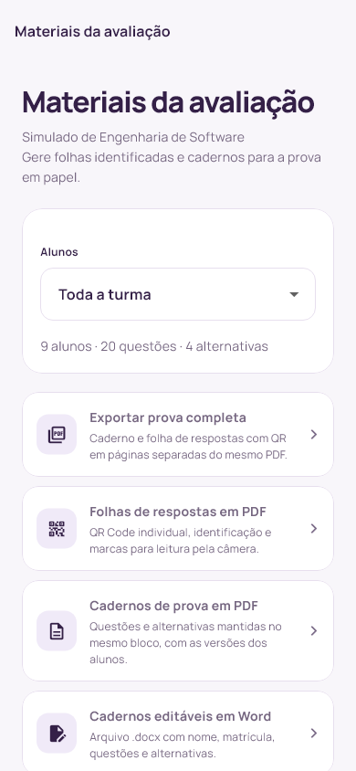

## 8. Ler e revisar uma folha

1. Toque em **iniciar correção** ou abra a aba **Leitura**.
2. Escolha a avaliação com o gabarito definido.
3. Use a câmera ou escolha uma foto da galeria/arquivo.
4. Fotografe a folha completa, com boa iluminação, foco e sem sombras fortes.
5. Confira a identificação e as respostas reconhecidas na tela de revisão.

O QR relaciona a imagem ao aluno e ao modelo. A folha deve pertencer à avaliação selecionada. O reconhecimento usa a folha de respostas produzida pelo EasyGrade; não corrige automaticamente o texto do caderno nem uma folha de outro modelo.

### Conferir antes de confirmar

- Compare as respostas exibidas com a folha física.
- Revise as marcações sinalizadas como incertas ou múltiplas.
- Selecione a alternativa correta conforme a marcação do aluno ou use **Registrar em branco**.
- Quando não houver pendências, toque em **Confirmar correção**.

As marcações pendentes impedem a confirmação. A revisão é uma etapa do fluxo, inclusive quando a leitura parece correta. Respostas em branco valem zero. Depois de confirmar, a nota passa a integrar os resultados.

A leitura é feita uma folha por vez. Se reler o mesmo aluno, confira o resultado antes de confirmar: a nova correção substitui a anterior, sem duplicar o aluno no relatório.

<p>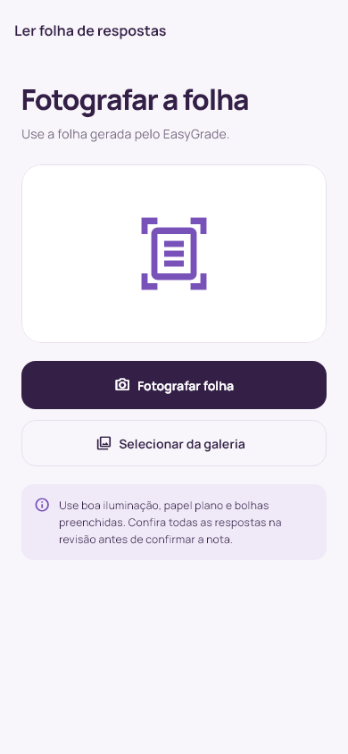 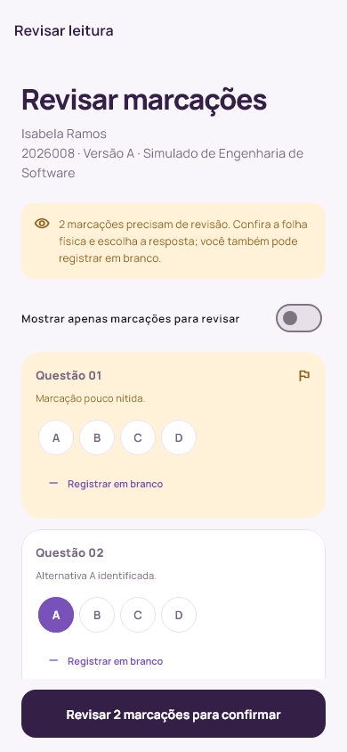</p>

## 9. Consultar resultados e exportar

Abra a avaliação e toque em **Resultados da turma**. Consulte o andamento, a média, a maior e a menor nota. Toque no aluno para conferir sua nota e respostas.

Em **Análise por questão**, escolha uma questão para ver taxa de acerto, alternativas mais marcadas e respostas em branco. As versões embaralhadas são relacionadas à ordem original para a análise.

Abra a opção de relatório, escolha o conteúdo e exporte para Excel. O relatório pode incluir notas e alternativas marcadas, conforme a opção selecionada. Use o compartilhamento ou salvamento oferecido pelo dispositivo.

A ação de concluir registra o encerramento da avaliação e pode informar alunos ainda pendentes. Ela não impede a continuidade da leitura das folhas restantes.

<p>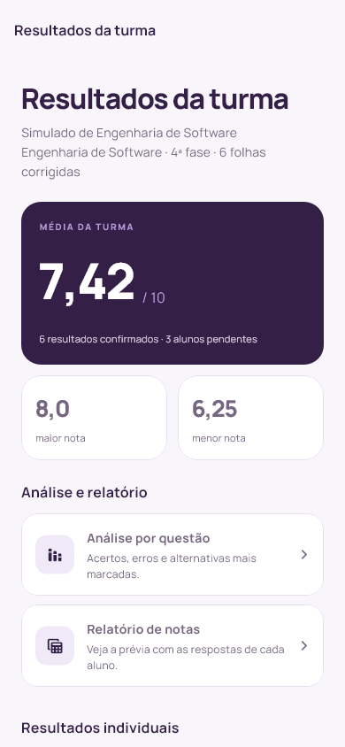 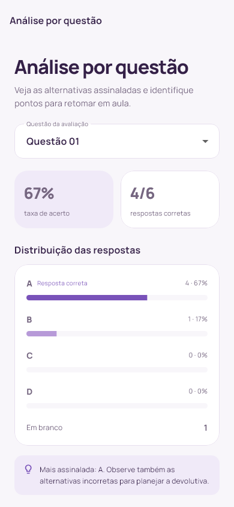</p>

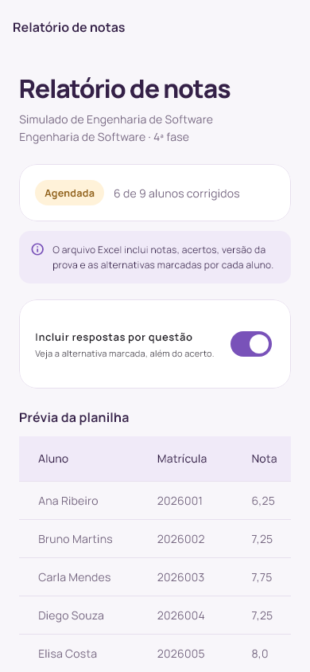

## 10. Perfil, preferências e saída

Na aba **Perfil**, use **Editar perfil** para alterar nome e instituição. O e-mail permanece vinculado à conta usada no acesso. Quando o login Google fornecer uma foto, ela aparece no perfil e no início.

Em **Configurações → Pontuação padrão**, escolha o limite para as novas avaliações neste dispositivo. A alteração não modifica as avaliações já criadas. A abertura respeita a preferência de redução de movimento do aparelho.

Use **Como funciona** para consultar a ajuda resumida. Para encerrar a sessão, toque em **Sair da conta**. Entrar com uma conta diferente mostra os dados dessa outra conta.

<p>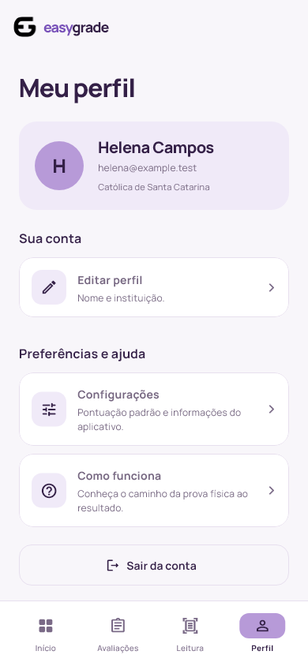 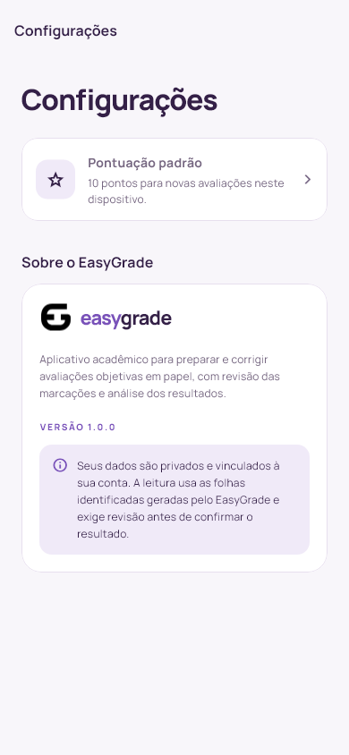</p>

## 11. Resolver dúvidas e problemas

| Situação | O que fazer |
| --- | --- |
| Não consigo entrar. | Confira o e-mail e a senha, a conexão e o método de acesso. Para senha esquecida, use **Esqueci minha senha**. |
| Meus dados não aparecem. | Confira se entrou na mesma conta usada antes e aguarde o carregamento com internet. Não recrie a turma antes de conferir a conta. |
| A câmera não abre. | Confira a permissão de câmera nas configurações do Android. Como alternativa, selecione uma foto existente. |
| A folha não é reconhecida. | Use o PDF original da avaliação correta, imprima sem redimensionar e tente outra foto com foco e luz adequados. |
| O QR pertence a outro modelo ou ficou desatualizado. | Confira avaliação e aluno; use os materiais gerados após a última alteração dos modelos. |
| Uma questão do banco está desabilitada. | Confira se sua quantidade de alternativas coincide com a avaliação. |
| Os pesos ultrapassam o limite. | Reduza um ou mais pesos. Alterar um peso não ajusta automaticamente os demais. |
| Não consigo editar pesos ou composição. | Essas informações ficam preservadas após a primeira correção. Prepare outra avaliação para aplicar um formato diferente. |
| O aluno aparece como pendente. | A nota só entra nos resultados depois de revisar e confirmar a correção. |
| A impressão pede várias confirmações. | Gere **Toda a turma** e imprima o PDF completo em uma operação. A interface de impressão também depende do aparelho e da impressora. |
| O aplicativo informa falha ao salvar. | Confira a conexão e tente novamente; não considere o resultado confirmado antes da mensagem de sucesso. |

Se o problema persistir, informe à equipe do projeto a versão do aplicativo, a etapa e a mensagem exibida. Ao compartilhar uma imagem para suporte, oculte dados reais dos alunos. O repositório do projeto é [Juuh1/EasyGrade](https://github.com/Juuh1/EasyGrade).

## 12. Termos usados no aplicativo

| Termo | Significado |
| --- | --- |
| Avaliação | Cadastro da prova, seu formato, gabarito e resultados. |
| Caderno | Documento com enunciados e alternativas, entregue ao aluno. |
| Folha de respostas | Documento padronizado onde o aluno marca as alternativas e que será fotografado. |
| Gabarito | Respostas corretas usadas como referência para a correção. |
| Peso | Quantidade de pontos de uma questão acertada. |
| Versão/modelo | Organização A ou B das questões e alternativas. |
| QR Code | Identificação automática da folha, do aluno e do modelo. |
| Revisão | Conferência pelo professor antes de gravar a correção. |

**[Voltar ao README do projeto](../README.md)**
